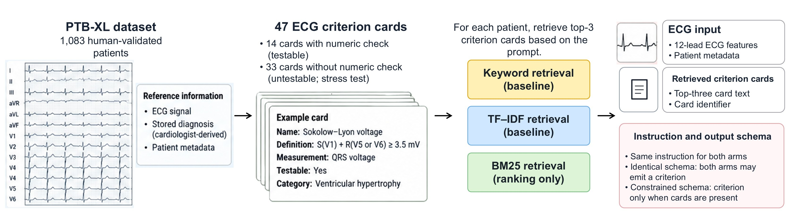

# RAG-TRACE

[](https://www.python.org/)
[](https://numpy.org/)
[](https://pandas.pydata.org/)
[](https://scikit-learn.org/)
[](https://scipy.org/)
[](https://physionet.org/content/ptb-xl/1.0.3/)
[](https://physionet.org/content/ptb-xl-plus/1.0.1/)
[](LICENSE)

Tracing measurement evidence and diagnostic completeness in AI-generated ECG reports.

<p align="center">
  
</p>

A language model drafts an electrocardiogram note, sometimes after reading retrieved criterion cards. A deterministic rule then withdraws an applied criterion when the card has no numeric check or the Marquette 12SL predicate is false. Diagnoses are not rewritten. Uni-G is scored afterward as a second measurement program. This repository measures whether a retrieved criterion can be checked. It does not estimate clinical safety.

**Elyas Irankhah** · Postdoctoral Associate, Yale University · [Google Scholar](https://scholar.google.com/citations?user=Erg664sAAAAJ&hl=en) · [elyas.irankhah@yale.edu](mailto:elyas.irankhah@yale.edu)

## Study

The held-out sample is one test-fold electrocardiogram per patient from PTB-XL 1.0.3 (seed 11): 1,083 human-validated patients. Measurements come from PTB-XL+ 1.0.1. The criteria library has 47 cards. Fourteen have a numeric check. Thirty-three do not. Retrieval uses asserted superclass words from a calibrator fit on folds 1–8 and calibrated on fold 9. Stored test labels are not in the query. Keyword overlap, TF–IDF, and Okapi BM25 each return three cards. BM25 is a ranking comparison on the saved queries. It does not write a new note.

Two diagnosis comparisons hold the instruction fixed.

| Comparison | What is held fixed | Hypertrophy recall |
|---|---|---|
| Identical schema | One instruction and one JSON schema. Both arms may emit a criterion. | 0.626 and 0.626 (67 of 107) |
| Different schema | The same instruction. A criterion is admitted only when cards are present. | 0.617 to 0.514 |

On the identical-schema pair, unsupported criteria are 17.4% without cards and 31.1% with keyword cards. On the different-schema pair, diagnosis micro-F1 moves from 0.804 to 0.795. Six of the eleven apparent no-card hypertrophy detections in that pair are a saved HYP label on a hypertension sentence.

Keyword retrieval on the full library produced an untestable or rejected card in 46.8% of gpt-4.1-mini notes. Of 647 withdrawals, 639 had no numeric check. Requiring a retrieved identifier on the 14 checked cards lowered the release score to 3.0%.

## Data

The notes and the score files are in this repository, under `results/ptbxl_baseline/`. Rescoring them does not call a model and does not need a key.

The waveforms are not in this repository. They are the public PhysioNet releases:

- [PTB-XL 1.0.3](https://physionet.org/content/ptb-xl/1.0.3/)
- [PTB-XL+ 1.0.1](https://physionet.org/content/ptb-xl-plus/1.0.1/)

`download_ptbxl.py` fetches both from the public bucket `physionet-open`. Their licenses stay with PhysioNet.

## Reproduce

```powershell
python -m venv .venv
.\.venv\Scripts\Activate.ps1
python -m pip install -r requirements.txt
python diagnosis_prf.py
python matched_intervals.py
python micro_f1_forest.py
python offline_day.py
python retention_paired.py
```

`diagnosis_prf.py` reads `results/ptbxl_baseline/case_record.csv` and the 12SL feature table from PTB-XL+. Run `python download_ptbxl.py` once before the first score. Keep NumPy at 1.24.3.

## Scripts

| Script | Role |
|---|---|
| `diagnosis_prf.py` | Precision, recall, F1, omissions, and false-diagnosis notes |
| `matched_intervals.py` | Paired intervals for the different-schema comparison |
| `micro_f1_forest.py` | Micro-F1 change and bootstrap interval for each model |
| `offline_day.py` | Keyword, TF–IDF, and BM25 on the saved queries |
| `retention_paired.py` | Untestable cards, failed 12SL checks, and retained cards |
| `hyp_read.py` | Hypertrophy counts on the two schema comparisons |
| `score_qwen_independent.py` | Uni-G and statement scores for Qwen3-8B |
| `score_glm_independent.py` | Uni-G and statement scores for GLM-5.3-Flash |
| `claim_scoring.py` | Prespecified affirmation list and the 12SL withdrawal |
| `diagnosis_rule.py` | Label-aware diagnosis count |
| `ecg_guard.py` | Frozen fold-9 margins and the three-state check |
| `knowledge/ecg_criteria_v2.json` | 47-card library. SHA-256 `dc289fe2434bc799cbf4346272468970f2d47a3e2aceebca3f792bc61eddbf6c` |

## License

Code and criteria cards are released under the MIT license. PTB-XL and PTB-XL+ remain under their PhysioNet licenses and are not redistributed here.
